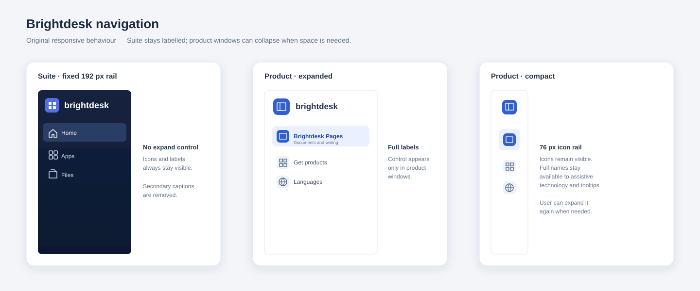

# Brightdesk Design System

The canonical visual foundation for the ten Brightdesk Office Suite products.

## Implemented foundations

- `css/tokens.css` defines shared workspace colours, typography, spacing, borders, focus and elevation tokens.
- `css/product-window.css` defines the focused product-window shell used by individual product editions.
- Product-specific accent colours remain owned by each product. The shared shell reads the existing `--bd-accent` token rather than forcing one colour across the portfolio.

## Product-window behaviour

Each individual product edition receives its product identity from its existing launch argument. In that mode, the window:

- opens directly into the selected product workspace;
- replaces Suite product-management navigation with the product's own labelled navigation rail and removes the generic welcome banner;
- keeps the product name, product icon, local-save state and relevant file actions visible;
- gives the product workspace the remaining window area;
- adapts navigation between a 232 px expanded rail (1008 px and wider), a 76 px compact icon rail (641–1007 px), and a menu button at 640 px and below that opens the navigation over the workspace;
- uses a Brightdesk-specific 76 px icon rail at medium widths; Fluent 2's standard Nav guidance uses a labelled drawer and an overlay drawer at 640 px and below, and does not define an icon-only Nav layout;
- keeps domain-specific navigation inside the product workspace where that feature exists.

The Suite itself does not receive the product-window class. Its Home, Apps, Files and product-switching experience therefore remains separate.

## Navigation reference

The Suite uses a fixed 192 px labelled rail with no expand/collapse control. Individual product windows use the adaptive states above. The reference SVG is original Brightdesk design artwork, not a screenshot from a running desktop build.

## Product workspace orientation

| Product | Primary workspace orientation |
| --- | --- |
| Pages | Document page centred in an editing canvas, with document controls and ribbon above |
| Sheets | Formula controls above a full-width spreadsheet grid |
| Decks | Slide navigation on the left, presentation canvas in the centre, slide controls below |
| Notes | Focused note editor with its own formatting controls |
| Database | Table navigation beside the selected table and its records |
| Forms | Form builder and response views with question controls |
| Lists | List navigation beside the selected records table |
| Planner | Planning buckets and task cards arranged as a board |
| To Do | Task views on the left, searchable task list in the main area |
| Workspace | Project navigation and editable project content in a clear content workspace |

These are layout rules, not claims that every planned feature is implemented. Each product README must distinguish working functionality from design artwork and future scope.

## Integration model

The CSS in this repository is the canonical source. Product repositories keep a local copy inside their packaged source tree so the applications remain local-first and do not need a network connection or a runtime dependency on this repository. Changes to the canonical files must be mirrored and verified in each product repository.

## Brand and accessibility rules

Brightdesk uses original product names, icons, colour relationships, layouts and artwork. Familiar productivity conventions are welcome, but do not copy another vendor's logos, proprietary assets, source code or distinctive screen composition. Keep controls keyboard accessible, use visible focus states, respect reduced-motion settings, preserve readable contrast and prevent horizontal overflow at smaller widths.

## Current status

The canonical tokens and product-window shell are now defined in this repository. Consumer integration is reviewed in the individual product repositories; this repository alone does not prove that all ten products have adopted the system.
